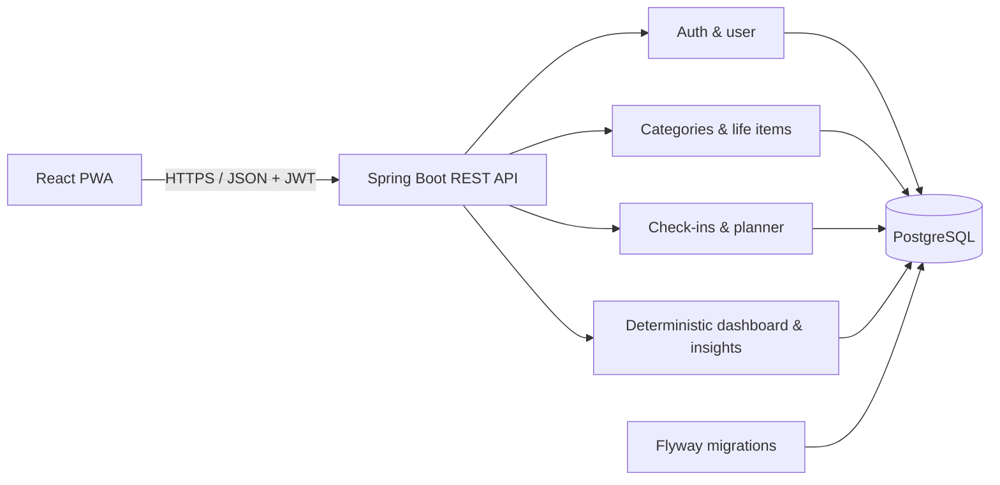

# Architecture

Tend is a feature-based modular monolith. One deployable Spring Boot application owns a relational PostgreSQL database. Module boundaries remain explicit so features can evolve without the operational burden of microservices.

The current `life_item` aggregate covers the common fields of brain dumps, goals, tasks, and habits. Feature-specific tables—habit completion now, and experiment/health/journal tables in Phase 2—preserve relational integrity without prematurely duplicating shared workflow fields.

AI is intentionally absent from the MVP. A future application service can consume explicit, consented DTOs; it must never receive sensitive data implicitly.
